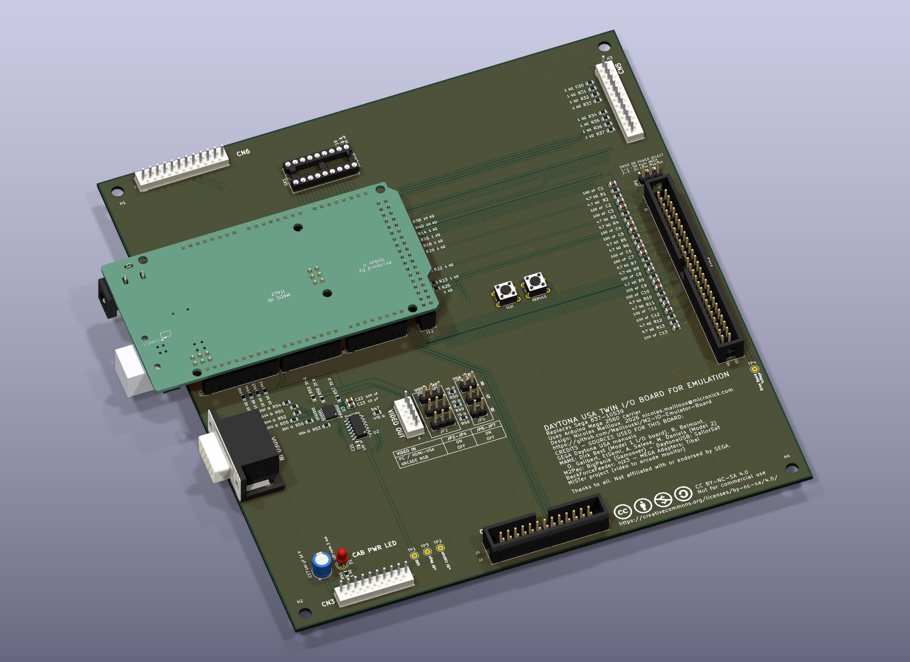
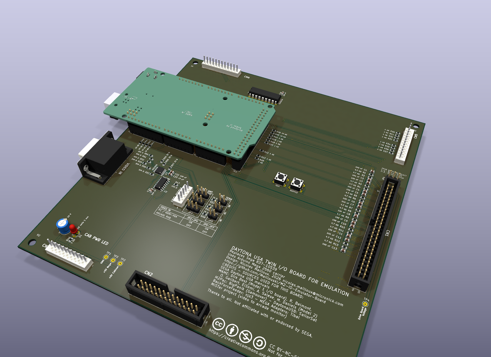
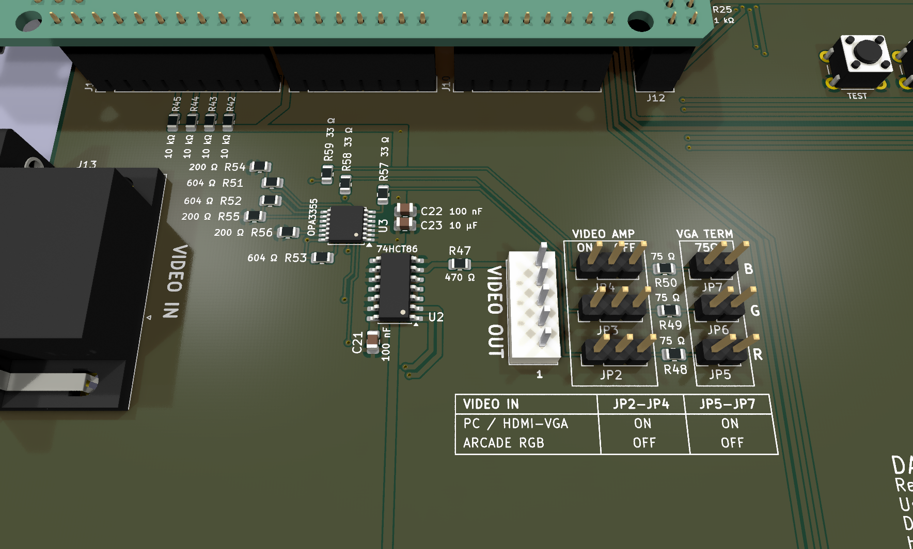
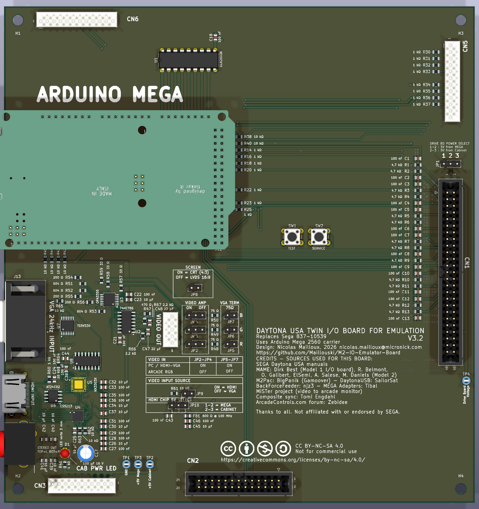
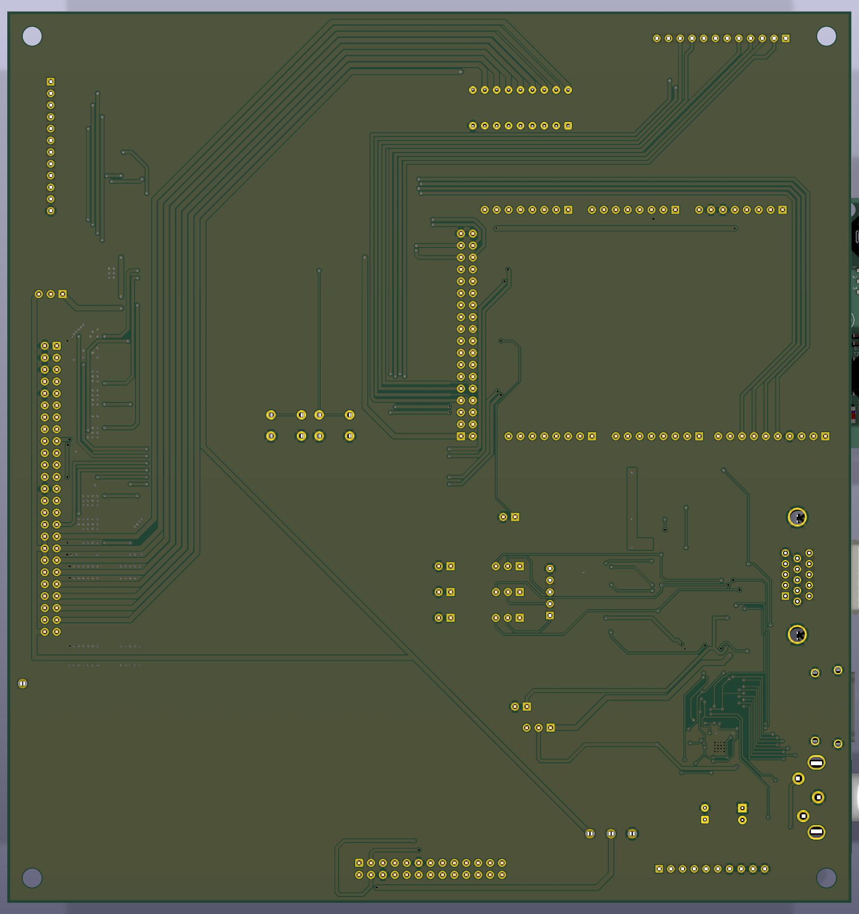

# M2 IO Emulator Board

[English](README.md) | **Français**

Carte de remplacement direct de la **carte E/S Sega 837-10539** de la borne **Daytona USA twin** (Sega Model 2), construite autour
d'un **Arduino Mega 2560**. Elle permet à un émulateur de piloter la borne d'origine : commandes, lampes, compteurs, drive board
d'origine (retour de force) et moniteur arcade d'origine.

> **État : prototype.** Le design passe la DRC et l'ERC, mais aucune carte n'a encore été fabriquée ni testée. Lire les
> [points ouverts](#points-ouverts) avant de commander.

## Ce qu'elle fait

L'idée est simple : on sort la carte E/S Sega de la borne et on met celle-ci à sa place. Elle a les mêmes dimensions, les mêmes
trous de fixation et les mêmes noms de connecteurs, donc le faisceau d'origine se branche directement. Rien n'est coupé ni
recâblé.

Une fois en place, l'Arduino Mega fait le pont entre l'émulateur et la borne. Il lit les commandes et pilote tout ce que la carte
d'origine pilotait :

- **Commandes** — volant, accélérateur, frein, levier de vitesses, monnayeur, START, boutons de vue VR, TEST et SERVICE.
- **Lampes, compteurs et relais** — commandés par un ULN2803A : les ampoules et les compteurs d'origine continuent de
  fonctionner.
- **Retour de force** — la drive board d'origine reste dans la borne et reçoit ses ordres du Mega : le volant garde son retour de force
  d'origine.
- **Vidéo** — une entrée VGA va au moniteur arcade d'origine, avec la synchro composite fabriquée sur la carte. Un petit ampli
  vidéo, activable par cavaliers, remonte le signal d'une source PC ou d'un adaptateur HDMI-VGA au niveau qu'attend le tube.

Quelques détails pratiques facilitent la mise en route : boutons TEST et SERVICE directement sur la carte, DEL d'alimentation,
points de test pour chaque alimentation, et un cavalier (JP1) pour choisir si la logique de la drive board est alimentée par le
5 V du Mega ou par celui de la borne.

## Cavaliers vidéo

| VIDEO IN (J13) | JP2-JP4 (VIDEO AMP) | JP5-JP7 (VGA TERM 75 Ω) |
|---|---|---|
| PC / adaptateur HDMI-VGA | ON | ON |
| RGB arcade | OFF | OFF |

Le même tableau est imprimé sur la carte (en anglais).

## Vues 3D

Rendus KiCad 10 tirés des fichiers de ce dépôt.

| | |
|---|---|
|  |  |
| Vue en perspective | Section vidéo : entrée VGA, ampli OPA3355, cavaliers et tableau de réglage |
|  |  |
| Dessus | Dessous |

## Contenu du dépôt

| Chemin | Contenu |
|---|---|
| `kicad/` | projet KiCad 10 : schéma, PCB, règles de conception, librairie d'empreintes du projet (`interface-borne.pretty`), modèles 3D |
| `fabrication/` | Gerbers, fichiers de perçage Excellon et leurs plans (`gerbers/`), les mêmes fichiers en zip pour le fabricant, fichier de placement ; BOM et CPL JLCPCB pour l'assemblage des CMS ([`jlcpcb/`](fabrication/jlcpcb/README.fr.md)) |
| `bom/` | BOM complète ([`BOM.fr.md`](bom/BOM.fr.md), [English](bom/BOM.md)) et fichier d'import DigiKey ([`BOM-digikey.csv`](bom/BOM-digikey.csv)) |
| `docs/` | schéma en PDF, rendus de la carte |

Carte : 2 couches, 180 × 190 mm. Les Gerbers sortent des réglages de tracé enregistrés dans le PCB (KiCad 10).

## Points ouverts

À vérifier avant de commander ou de mettre sous tension :

1. **Pas des connecteurs NH** : vérifié. CN3, CN5, CN6 et J14 utilisent des empreintes JST NH au **pas de 2,5 mm**. Mesures au
   pied à coulisse sur une carte Sega d'origine et sur la borne : CN3, 22,54 mm de la broche 1 à la broche 10 ; CN5, 27,42 mm
   de la broche 1 à la broche 12 ; fiche vidéo à 5 broches de J14, 10,00 mm de la broche 1 à la broche 5.
2. **Ordre des broches de J14** : vérifié sur une borne Daytona USA twin : 1 rouge, 2 vert, 3 bleu, 4 synchro (fil noir rayé
   blanc), 5 masse (fil blanc). C'est l'ordre de J14.
3. **Niveau vidéo.** Le gain de l'ampli (4,02, fixé par R51-R56) suppose une source qui sort 0,7 V sur 75 Ω. Ce n'est pas mesuré.
   Changer R54-R56 pour l'ajuster.
4. **CN1 et CN2** sont des embases 3M simples à quatre murs, sans leviers d'éjection. On a vérifié que la fiche CN1 de la borne
   y entre.
5. **Le firmware** du Mega ne fait pas partie de ce dépôt.

## Modèles 3D

Le modèle de l'Arduino Mega dans `kicad/3d/` est dérivé des fichiers CAO d'Arduino (CC BY-SA 4.0) et de modèles de la
bibliothèque KiCad ; voir [`kicad/3d/README.fr.md`](kicad/3d/README.fr.md). Les connecteurs JST NH utilisent des modèles
simplifiés faits pour ce projet (embase et broches).

## Crédits

Sources utilisées pour cette carte : manuels SEGA de Daytona USA ; MAME (Dirk Best pour la carte E/S Model 1 ; R. Belmont,
O. Galibert, ElSemi, A. Salese, M. Daniels pour le Model 2) ; M2Pac de BigPanik (Gamoover) ; DaytonaUSB de SailorSat ;
BackForceFeeder de njz3 ; adaptateurs MEGA de Tibal ; le projet MiSTer (vidéo vers moniteur arcade).

Projet non affilié à SEGA ni approuvé par SEGA.

## Licence

© 2026 Nicolas Mailloux. **CC BY-NC-SA 4.0** — voir [`LICENSE`](LICENSE) (texte officiel en anglais).
Vous pouvez fabriquer, utiliser, modifier et partager cette carte, à condition de citer l'auteur, de garder les crédits et de
partager vos modifications sous la même licence. **Aucun usage commercial** : ne vendez ni la carte, ni les fichiers, ni un dérivé.
